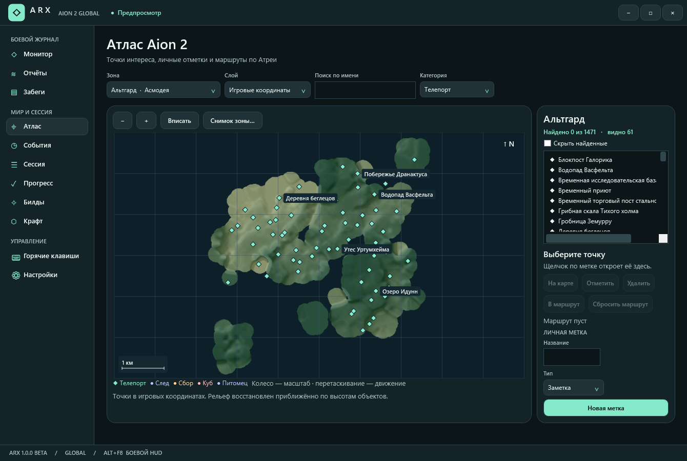

# ARX 1.0.2 beta

Общедоступный помощник для Aion 2 Global на Windows.

[Бета-релизы](https://github.com/Kadjiru/ATX/releases) · [Установка и работа](ARX%20beta%200.2.0%20source%20dat/README.md) · [Код приложения](ARX%20beta%200.2.0%20source%20dat) · [Источники](ARX%20beta%200.2.0%20source%20dat/SOURCES.md)

Личный DPS и DPS каждого участника через Npcap, отдельные HUD, отчёты и забеги, встроенная карта, таймеры, личный прогресс и локальный справочник.

Миникарта ARX работает поверх игры и использует метки Атласа. В боевом HUD показаны DPS и общий урон вашей группы. Статус обновления доступен из верхней строки клиента.

В «Билдах и гайдах» можно сохранить PvE-сборку для каждого персонажа и найти подсказки по боям. Вкладка «Питомцы» содержит справочник, способы получения и памятку по развитию семейств.

[Миникарта HUD](docs/arx-beta-102-minimap.png) · [Билды](docs/arx-beta-101-builds.png) · [Гайды по боям](docs/arx-beta-101-guides.png) · [Питомцы](docs/arx-beta-101-pets.png) · [Мастерская](docs/arx-beta-100-craft.png) · [Окно обновления](docs/arx-beta-100-update.png) · [HUD мировых боссов](docs/arx-beta-024-bosses.png)
