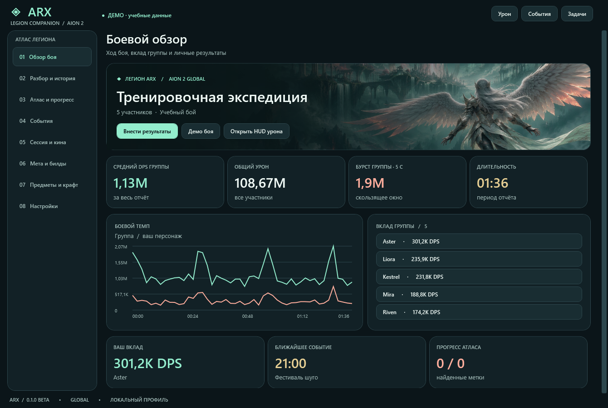

# ARX 0.1.0 beta

Помощник легиона **ARX** для Aion 2 Global на Windows.

[Бета-релиз](https://github.com/Kadjiru/ATX/releases/tag/v0.1.0-beta) · [Установка и работа с ARX](ARX%20beta%200.1.0%20source%20dat/README.md) · [Исходный код](ARX%20beta%200.1.0%20source%20dat) · [Источники данных](ARX%20beta%200.1.0%20source%20dat/SOURCES.md)

В этой ветке находится новая сборка ARX. Она использует локальные боевые отчёты, авторский атлас, три независимых HUD, справочник и общий набор меток и таймеров легиона.

