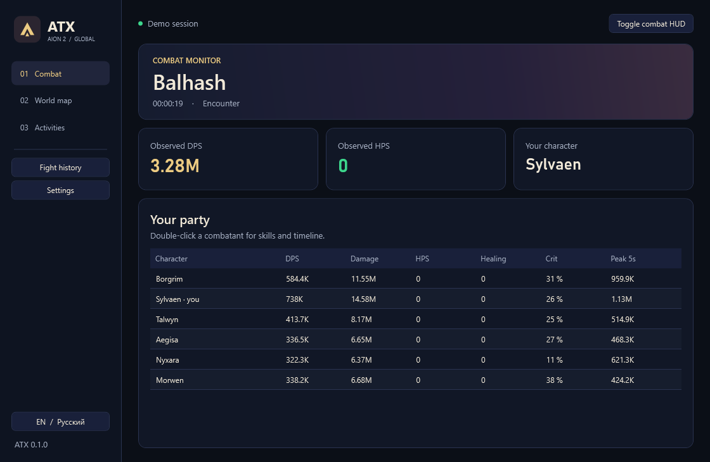

# ATX for Aion 2

[Русский](README.ru.md) · [Installation](INSTALL.txt) · [GPL-3.0](LICENSE)

ATX is a Windows companion for **Aion 2 Global (EU/NA)**. It brings a combat dashboard, configurable HUD, fight history, world map, and activity countdowns into one app.

## Install and connect

[Windows installer](https://github.com/Kadjiru/ATX/releases/latest/download/ATX-Setup.exe) · [Portable ZIP](https://github.com/Kadjiru/ATX/releases/latest/download/ATX-win-x64.zip)

1. Install [Npcap](https://npcap.com/#download) with its default options.
2. Run **ATX-Setup** or extract the portable package and open **ATX.exe**.
3. Start ATX before logging into your character, then join a party in the game. ATX starts capture automatically. The dashboard identifies your character when the login or loading packet arrives and fills **Your party** when the server sends its roster.
4. If the game was already open, change zones or teleport. If the party list remains empty, rejoin the party and check **Settings → Capture**. Start with automatic adapter selection. Try a specific adapter if you use a VPN or traffic relay.

Use borderless windowed mode for the HUD. The game may omit some participants' damage at crowded encounters. ATX labels that data as partial.

## In ATX

| Section | What you can do |
| --- | --- |
| Combat | See observed DPS, damage, HPS, critical rate and peak five-second DPS. Double-click a participant to open skills and the timeline. |
| History | Review automatically saved encounters and switch between live and saved fights. |
| World map | Explore Daeva Hub's Aion 2 map with zoom, zones, marker filters and a browser fallback. The embedded map needs internet and Microsoft Edge WebView2 Runtime. |
| Activities | Enter a name and duration, then show the next countdown over the game. For server event times use the linked Daeva Hub schedule. Field-boss timers read the list sent when you open **Map → Exploration → Field monsters** in Aion 2. |
| Settings | Switch RU/EN, change HUD color, scale and opacity, import/export a HUD appearance profile, and diagnose Npcap and adapter selection. |

| Shortcut | Action |
| --- | --- |
| Ctrl+Shift+D | Show/hide combat HUD |
| Ctrl+Shift+L | Toggle click-through for combat HUD |
| Ctrl+Shift+R | Save the current encounter and restart capture |
| Ctrl+Shift+T | Show/hide field-boss timers |
| Ctrl+Alt+T | Show/hide activity HUD |

HPS uses decoded healing during an active encounter divided by the encounter duration. Shields/absorption are currently unavailable. The five-second burst metric uses the largest five consecutive one-second damage buckets.

ATX passively captures local packets. It uses no game injection, memory reads, or game commands. History and settings are stored in **%AppData%\ATX**. Raw packet recording is off by default. The map, optional skill images, and update checks contact their respective providers. The app checks for new ATX releases on GitHub. Automatic installation can be enabled separately for installed copies.

## Build

On Windows x64, install the .NET 10 SDK. The installer build also needs Inno Setup 7.

~~~powershell
dotnet build AionMeter.sln -c Release
dotnet test AionMeter.sln -c Release --no-build
.\build-release.ps1
~~~

The release script creates a self-contained Windows package, installer when Inno Setup is available, and corresponding source archive in **dist**. The app looks for published stable releases in [Kadjiru/ATX](https://github.com/Kadjiru/ATX/releases).

## Credits and license

ATX is a modified distribution of [AION2 DPS Meter by cyberbadger6969 and contributors](https://github.com/cyberbadger6969/aion2-dps-meter). The upstream capture, protocol, combat, HUD and field-boss implementations are retained with their history. ATX adds the dashboard, embedded map, activity HUD, HPS and burst display, and HUD appearance profiles. See [data/NOTICE.md](data/NOTICE.md) for data provenance and [LICENSE](LICENSE) for GPL-3.0 terms.

Interactive map and server activity schedule by [Daeva Hub](https://daevahub.com/map/). Aion 2 and associated game artwork are property of NCSOFT. ATX is an independent project.
