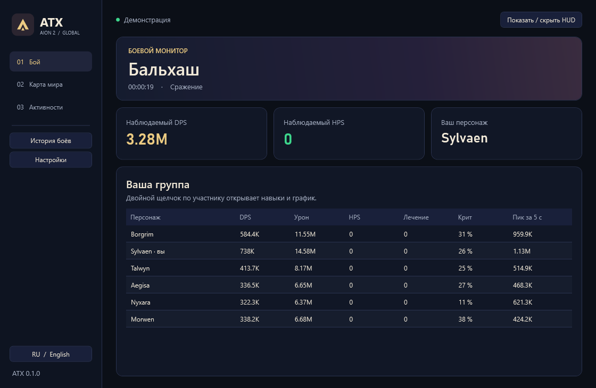

# ATX для Aion 2

[English](README.md) · [Установка](INSTALL.txt) · [GPL-3.0](LICENSE)

ATX — приложение для **Aion 2 Global (EU/NA)** на Windows. В главном окне доступны боевая статистика, интерактивная карта Атреи и таймеры активностей. Боевой HUD можно оставить поверх игры.

## Установка и подключение

[Установщик Windows](https://github.com/Kadjiru/ATX/releases/latest/download/ATX-Setup.exe) · [Портативный ZIP](https://github.com/Kadjiru/ATX/releases/latest/download/ATX-win-x64.zip)

1. Установите [Npcap](https://npcap.com/#download) с настройками по умолчанию.
2. Запустите **ATX-Setup** или распакуйте портативный архив и откройте **ATX.exe**.
3. Откройте ATX до входа в игру, выберите персонажа и вступите в группу. Захват запускается автоматически. Имя появится после пакета входа или загрузки, состав группы — после того, как сервер отправит список участников.
4. Если игра уже была открыта, смените локацию или телепортируйтесь. Если группа всё ещё не появилась, переподключитесь к группе и проверьте **Настройки → Захват**. Начните с автоматического выбора адаптера. При VPN попробуйте выбрать конкретный интерфейс.

Для HUD используйте оконный режим без рамки. На массовых боях сервер может прислать урон лишь части игроков. ATX отмечает такой отчёт как неполный.

## Возможности

| Раздел | Что доступно |
| --- | --- |
| Бой | DPS, урон, HPS, доля критических попаданий и пиковый DPS за 5 секунд. Двойной щелчок по игроку открывает навыки и график боя. |
| История | Сохранённые сражения и просмотр прошлых боёв в HUD. |
| Карта мира | Карта Daeva Hub с масштабированием, регионами и фильтрами меток. Для встроенной карты нужны интернет и Microsoft Edge WebView2 Runtime. Есть кнопка открытия в браузере. |
| Активности | Отсчёт по названию и длительности, уведомление Windows и мини-HUD ближайшего таймера. Расписание сервера открывается по ссылке Daeva Hub. Чтобы получить таймеры полевых боссов из игры, откройте **Карта → Исследование → Полевые монстры** в Aion 2. |
| Настройки | Русский и английский, цвет, масштаб и прозрачность HUD, экспорт и импорт профиля оформления, диагностика Npcap. |

| Клавиши | Действие |
| --- | --- |
| Ctrl+Shift+D | Показать или скрыть боевой HUD |
| Ctrl+Shift+L | Пропускать щелчки через боевой HUD |
| Ctrl+Shift+R | Сохранить текущий бой и перезапустить захват |
| Ctrl+Shift+T | Открыть или закрыть таймеры полевых боссов |
| Ctrl+Alt+T | Открыть или закрыть мини-HUD активностей |

HPS рассчитывается по распознанному лечению во время боя и длительности боя. Щиты и поглощение пока не измеряются. Пиковый DPS считается по максимальной сумме урона в пяти соседних односекундных интервалах.

ATX пассивно читает локальный трафик. Приложение хранит настройки и историю в **%AppData%\ATX**. Запись исходных пакетов по умолчанию выключена. Карта, загрузка изображений и проверка обновлений обращаются к соответствующим сервисам. Автоматическую установку обновлений можно включить отдельно в установленной версии.

## Сборка и лицензия

Для сборки нужны Windows x64 и .NET 10 SDK. Для установщика также нужен Inno Setup 7.

~~~powershell
dotnet build AionMeter.sln -c Release
dotnet test AionMeter.sln -c Release --no-build
.\build-release.ps1
~~~

Результаты появятся в **dist**. Код распространяется по [GPL-3.0](LICENSE). В основе ATX — открытый проект [AION2 DPS Meter](https://github.com/cyberbadger6969/aion2-dps-meter) от cyberbadger6969 и участников. Источники игровых таблиц перечислены в [data/NOTICE.md](data/NOTICE.md). Карта и расписание предоставляются [Daeva Hub](https://daevahub.com/map/). Aion 2 и игровые материалы принадлежат NCSOFT.
